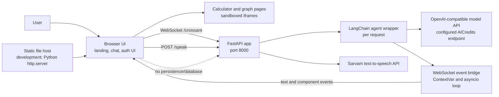
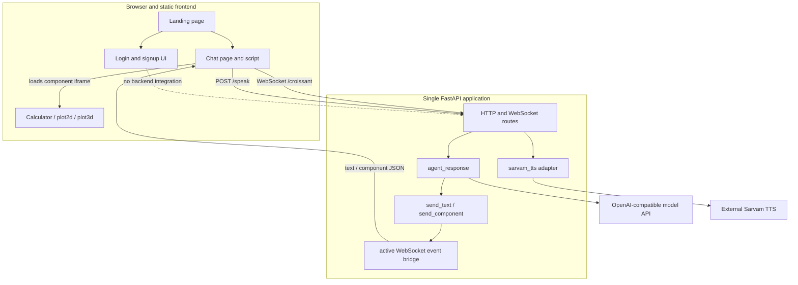
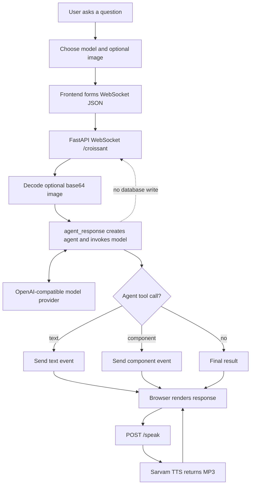
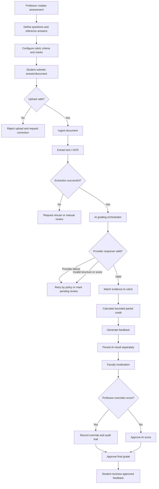
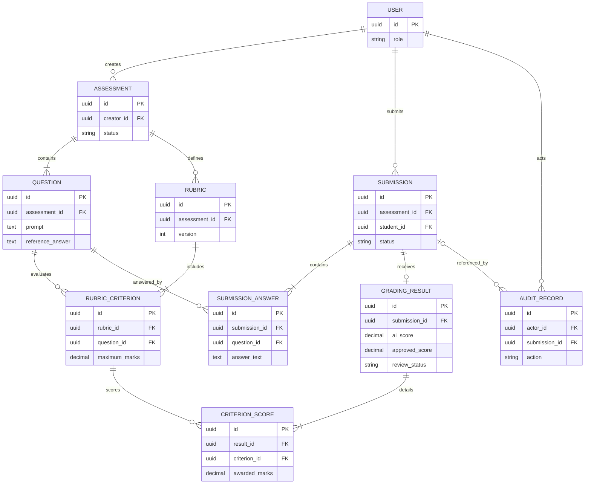
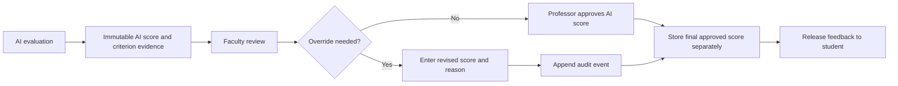

# Croissant Architecture

> **Scope and status:** This document describes the repository as inspected on 12 November 2026. Croissant currently implements a browser-based AI chat assistant. The assessment, student submission, grading, database, and faculty moderation workflows requested below are **proposed only**; no such implementation or schema is present in this repository.

## 1. System overview

Croissant lets a user chat with a model, optionally attach an image, request calculator or graphing tools, and play a spoken version of an assistant response. It provides a small, static landing and chat interface backed by one FastAPI application. The likely primary user is an individual exploring questions; the code does not define distinct user roles.

The implementation favors a small monolithic backend and static browser pages. The browser owns presentation and interaction; FastAPI owns request handling and invokes a LangChain agent; configured external providers supply model inference and text-to-speech. There is no real account system, durable conversation store, or assessment domain model. The login page includes five hard-coded demo profiles and a frontend-only profile view; it does not authenticate to the backend.



**Implemented:** Static HTML, CSS, and JavaScript; FastAPI; LangChain agent invocation; image-to-model input; calculator and plotter components; streamed tool text/component events; TTS. **Partially implemented:** Login validates five hard-coded fictional profiles in the browser, stores only the selected profile ID in `sessionStorage`, and opens a demo profile page. Sample credentials remain in frontend source and are not displayed in the UI. Signup remains UI-only. There is no server-side authentication or account creation. **Absent:** professor/student portals, assessments, grading, OCR, database, role authorization, and moderation. The repository README is empty (0 bytes), so it has no context sections to link here; source links are used instead.

## 2. Architectural layers

| Layer | Implemented responsibilities | Status / boundary |
|---|---|---|
| Presentation | Landing page, chat UI, model selector, image attachment, response rendering, audio playback, and isolated calculator/2D/3D plotting pages. | Implemented in [root `index.html`](../index.html), [`frontend/index.html`](../frontend/index.html), [`frontend/script.js`](../frontend/script.js), and [`frontend/components/`](../frontend/components/). Static login/signup are UI only. No professor dashboard, student portal, assessment editor, submission interface, grading results, or moderation interface exists. |
| Application / backend | HTTP/WebSocket request handling, image decoding, agent invocation, speech endpoint, health endpoint, and forwarding tool events to the active WebSocket. | Implemented in [`app.py`](../app.py), [`agent.py`](../agent.py), [`tools.py`](../tools.py), and [`websocket.py`](../websocket.py). No authentication/authorization, assessment or rubric management, submission management, grading orchestration, audit log, or grade approval. |
| AI intelligence | Selects a model ID from the frontend and sends user text and optional image to a LangChain agent through an OpenAI-compatible client. Agent tools can emit text and named UI components. | Implemented for general chat only. Semantic assessment, reference-answer comparison, rubric matching, partial credit, grading feedback, and structured-score validation are not implemented. The grading stages in §4 are proposed. |
| Document processing | Frontend accepts image files and sends base64 image data; backend decodes bytes and passes an image data URL to the model. | Image input only, not a document-ingestion pipeline. No PDF extraction, OCR, normalization, or handwritten-answer processing. |
| Data management | A random thread ID is generated in the browser and passed to the agent. LangGraph `InMemorySaver` is instantiated inside each `agent_response` call. | No database or file store exists. The saver is in-memory and request-local in this implementation; it does not provide durable cross-request history. There are no implemented user, assessment, rubric, submission, result, or audit entities. |

The requested professor/student presentation and assessment lifecycle are **proposed product scope**, not existing layers. They should not be described as current capabilities until implemented.

## 3. Component-level design

| Component | Responsibility, inputs, and outputs | Dependencies and interactions |
|---|---|---|
| Landing page | Introduces Croissant and links to chat, login, and signup. | Static assets and shared stylesheet; links to the chat page and frontend-only auth pages. |
| Chat page and script | Captures prompt, selected model, optional image; sends one WebSocket request; renders text, tool/component events, errors, and audio controls. | Browser APIs, Marked and DOMPurify CDN scripts, `styles.css`, static component documents, FastAPI `/croissant` and `/speak`. See [`frontend/script.js`](../frontend/script.js). |
| Auth UI | Login/signup forms, password visibility, client-side validation, and demo profile sign-in. | Static HTML/CSS and [`frontend/auth.js`](../frontend/auth.js); login checks a fixed local list, stores only a profile ID in per-tab `sessionStorage`, and routes to `frontend/dashboard.html`. No backend calls or account creation. |
| FastAPI app | Defines `/croissant` HTTP and WebSocket routes, `/speak`, `/health`, and permissive CORS middleware. | `agent_response`, `sarvam_tts`, and WebSocket event context. It does not serve the frontend files. See [`app.py`](../app.py). |
| Agent wrapper | Creates an OpenAI-compatible `ChatOpenAI` client and LangChain agent, prepares text or image input, invokes the agent, and returns the final message content. | AICredits-compatible model API, `system_promt.md`, `send_text`, `send_component`, LangGraph in-memory saver. See [`agent.py`](../agent.py) and [`system_promt.md`](../system_promt.md). |
| Tool/event bridge | Agent tools forward text or named components into the active WebSocket. | [`tools.py`](../tools.py) uses context-local active WebSocket state and schedules JSON sends on the asyncio loop in [`websocket.py`](../websocket.py). `send_tool_update` exists but is not called by the current tool functions. |
| Embedded utilities | Calculator and 2D/3D plotters run as separate static documents in sandboxed iframes. | Browser-side HTML/JavaScript only; no API or persistence. The parent maps only `calculator`, `plot2d`, and `plot3d`. |
| Speech adapter | Converts response text to MP3 bytes. | Sarvam SDK `SarvamAI`, model `bulbul:v4-flash`, `SARVAM_API_KEY`; called by FastAPI `/speak`. See [`Sarvam.py`](../Sarvam.py). |
| Grading orchestrator | No corresponding component exists. | **Proposed:** own the grading workflow in a future application layer, coordinate AI evaluation, validate output, persist results, and request faculty review. It must not be conflated with the current conversational agent. |



## 4. AI grading engine architecture

### Current AI path (implemented)

`agent_response` creates a `ChatOpenAI` client whose base URL is `https://api.aicredits.in/v1`, builds a LangChain agent with the prompt in `system_promt.md`, and provides two tools: `send_text` and `send_component`. For image input, the backend decodes base64 and the wrapper encodes the bytes into an image data URL for the model. The agent returns a final message; text/component tool events may arrive over the active WebSocket while it runs. This is general chat behavior, **not grading**. The in-memory saver is created for every call, so a stable browser thread ID alone does not establish durable history.

### Proposed grading pipeline (not implemented)

1. **Input preparation:** Resolve an assessment question, reference answer, rubric and maximum marks, and student answer. Validate that all belong to the same assessment/version and enforce input size/type limits.
2. **Semantic understanding:** Have an evaluator identify claims, concepts, methods, and supporting reasoning in the student response, including semantically equivalent wording. Treat the submission as untrusted content, not as evaluator instructions.
3. **Rubric matching:** Compare extracted concepts to each criterion and classify evidence as correct, incomplete, missing, or incorrect, retaining evidence spans and concise rationale.
4. **Partial-credit allocation:** Score each criterion independently within its configured maximum. Apply rubric-defined partial-credit rules, then sum criterion scores and verify the assessment maximum.
5. **Feedback generation:** Explain supported correct work, identify misconceptions and omissions, and suggest focused improvements. Keep feedback tied to the answer and rubric evidence.
6. **Output validation:** Parse a constrained structured response; validate required fields, criterion IDs, numeric types, per-criterion bounds, aggregate total, and completeness. On invalid output, retry under bounded policy or mark the attempt for human review; never silently approve a malformed grade.

The stages above describe a **proposed** AI grading design. No prompt, rubric schema, score calculator, response schema, retry policy, grading provider configuration, or AI output validator exists in the checked-in implementation.

```mermaid
sequenceDiagram
  autonumber
  actor Student
  participant UI as Student frontend (proposed)
  participant API as Backend API (proposed)
  participant Orchestrator as AI Grading Orchestrator (proposed)
  participant Provider as AI provider
  participant DB as Database (proposed)
  Student->>UI: Submit answer and attachment
  UI->>API: POST submission
  API->>DB: Load assessment, question, rubric and version
  DB-->>API: Grading inputs
  API->>Orchestrator: Question + reference + rubric + answer
  Orchestrator->>Provider: Request concept analysis and criterion evidence
  Provider-->>Orchestrator: Structured candidate evaluation
  Orchestrator->>Orchestrator: Validate evidence, bounds, totals and completeness
  alt Valid evaluation
    Orchestrator->>DB: Persist immutable AI result and criterion scores
    DB-->>Orchestrator: Result identifier
    Orchestrator-->>API: Score, rationale and feedback (pending review)
    API-->>UI: Show pending result
  else Invalid or incomplete evaluation
    Orchestrator->>DB: Record failure/review state (proposed)
    Orchestrator-->>API: Review required; no final grade
    API-->>UI: Show pending review status
  end
  Note over UI,DB: Proposed target only. Current Croissant has no submission API, grading orchestrator, database, or such provider contract.
```

## 5. Data flow architecture

### Current chat flow

1. User opens the landing page and follows the assistant link.
2. Browser creates a random thread ID and selects a model from a frontend list.
3. User enters text and optionally attaches an image. The frontend converts an image to base64.
4. Browser opens `ws://localhost:8000/croissant` (or `wss` for an HTTPS API URL) and sends a JSON object with query, model ID, thread ID, optional base64 image, and media type.
5. FastAPI decodes the image, then calls `agent_response` in a worker thread.
6. LangChain invokes the configured model; tools can send text/component JSON events over the current WebSocket.
7. FastAPI sends the final result or an error. The frontend renders Markdown and any component iframe.
8. The frontend separately posts response text to `/speak`; Sarvam returns MP3 audio. No chat result is persisted to a database.



### Assessment and grading workflow (proposed only)

The requested education workflow does not exist in the codebase. The diagram is a target-state proposal, not an implemented data flow.



Alternative flows in this target design: invalid upload is rejected before processing; extraction/OCR failure remains ungraded and requests correction or manual review; provider outage is retried only under a bounded policy then queued for review; malformed evaluation is never presented as an approved grade; score override preserves the original AI result and records the professor's change and rationale. These controls are recommendations, not current behavior.

## 6. Database architecture

**Implemented schema: none.** Repository inspection found no SQL, ORM models, migration files, database configuration, repository layer, or database dependency. There are therefore no implemented tables, keys, foreign keys, persistence guarantees, or relationships to diagram. Conversation state uses LangGraph `InMemorySaver` constructed within `agent_response`; this is process memory, not a database, and is recreated per call.

The following is a **proposed conceptual schema** for a future assessment system, not a schema found in the repository:



Any real schema would need explicit tenancy/ownership, assessment and rubric versioning, uniqueness rules, grade precision, retention policy, and treatment of uploaded files. No such decisions can be confirmed from this codebase.

## 7. API and integration architecture

The HTML frontend is not served by FastAPI. In development, it is served separately (for example, with Python's static HTTP server); the chat JavaScript currently targets `http://localhost:8000`. FastAPI enables wildcard CORS. The backend API and UI therefore have separate origins in common development setups.

| Interface | Implemented contract |
|---|---|
| `POST /croissant` | FastAPI handler with `query`, `model_name`, and `thread_id` as request parameters, plus optional multipart `image`; returns the final agent response. |
| `WS /croissant` | Accepts one JSON message containing `query`, `model_name`, `thread_id`, optional base64 `image`, and optional `image_media_type`. Emits `text` and `component` tool events and a final `result`, or an `error`. Frontend also handles `tool_update`, but the current tool functions do not call its producer. |
| `POST /speak?text=…&language=…` | Returns `audio/mpeg`; delegates to Sarvam TTS. The frontend uses `en-IN`; the endpoint default is `en-US`. |
| `GET /health` | Returns `{"status":"alive"}`. |

The AI client uses `langchain-openai`'s `ChatOpenAI` with a configured OpenAI-compatible base URL and model IDs selected in [`frontend/script.js`](../frontend/script.js). TTS uses the Sarvam SDK. `api_key` and `SARVAM_API_KEY` are read from environment configuration via `python-dotenv`; never place their values in documentation. CDN integrations are Marked, DOMPurify, and Google Fonts. No document processing, database, authentication provider, or assessment/grading API integration exists.

## 8. Human-in-the-loop architecture

**Implemented:** None. There is no professor role, moderation queue, score, approval state, or audit logging.

**Proposed:** Store the AI-generated score, criterion evidence, explanation, and model/prompt/rubric version as an immutable grading result. A professor reviews that result, can enter an override with reason, and approves the final score. Persist the approved score as a separate decision with actor and timestamp, and present only the approved grade as final to the student.

Keeping AI and professor scores separate preserves provenance, enables review of overrides and AI quality, and prevents a human decision from erasing what the model originally produced.



This is proposed; no diagram node corresponds to a current route or database table.

## 9. Security and reliability

| Area | Observed implementation | Recommended improvement (not implemented) |
|---|---|---|
| Authentication and authorization | The browser supports demo-only checks against five profiles. No server-side auth or role checks exist; the demo dashboard is not a protected backend resource. | Add a real identity provider/session model and enforce student, faculty, and administrative roles server-side before adding protected educational workflows. |
| CORS / transport | FastAPI permits all origins, methods, and headers. UI currently uses a local HTTP API URL and derives `ws`/`wss` from its scheme. | Restrict origins, methods, and headers per deployment; use HTTPS/WSS and environment-based API origin configuration. |
| Credentials | Provider keys are read from environment via dotenv. No key values are needed in browser code. | Keep secrets in a managed secret store in deployment, rotate on exposure, and avoid logging them. |
| File handling | Frontend accepts image MIME types; backend base64-decodes image content. No explicit size limit, allowlist validation, malware scan, or persistent file store is visible. | Validate content and size server-side; isolate processing; apply retention/deletion controls. Add safe PDF/OCR ingestion only when designed. |
| Student privacy | No student records or persistence layer exists. A user prompt/image is sent to the configured external model service; response text is sent to Sarvam for speech. | Establish provider/data-retention review, minimization, consent/notice, encryption, and retention policy before handling educational records. |
| Prompt injection | No grading or untrusted-submission isolation exists. | In a grading design, delimit submissions as data, prevent them from changing system instructions/tool policy, minimize tool access, and validate output independently. |
| AI output | General chat output is returned as text; browser Markdown is sanitized with DOMPurify. There is no structured grading response. | For grading, parse a strict schema and validate criterion membership, ranges, totals, and rationale before persistence/release. |
| Error handling | WebSocket handler catches exceptions and returns an error event; frontend displays it. TTS failures are caught and audio becomes unavailable. No bounded retry, timeout policy, durable queue, or structured server logging is evident. | Add timeouts, bounded retries/backoff, safe error messages, structured operational logs, tracing, and recovery procedures. |
| Availability / concurrency | Agent invocation runs via `asyncio.to_thread`; tool events schedule sends with `run_coroutine_threadsafe`. | Add connection lifecycle tests, backpressure/timeouts, resource limits, and a job queue only if workload warrants it. |

## 10. Scalability and future architecture

No scale targets or workload measurements are defined, so infrastructure changes should be driven by observed needs. A reasonable evolution path is:

1. Add assessment, rubric, submission, result, and audit persistence with explicit versioning and ownership.
2. For batch grading, accept submissions into a durable queue and run bounded workers; expose pending/running/completed/review-required states rather than holding long HTTP requests open.
3. Separate file storage and extraction from grading. Add PDF text extraction first; add OCR for handwriting as a separately validated capability.
4. Evaluate embedding-based retrieval/matching as an aid to rubric evidence, not as an unreviewed grade authority. Add step-aware mathematical or programming evaluators only with domain-specific tests and sandboxing.
5. Add retrieval-augmented learning resources and analytics only after access controls, retention, and data lineage are defined.

All items above are **proposed enhancements**. No queue, worker service, object store, OCR engine, vector database, sandbox, RAG layer, analytics pipeline, or grading microservice currently exists. The current architecture is a monolith; a modular monolith and background workers are plausible future choices before considering service decomposition.

## 11. Architecture decisions and trade-offs

| Observed choice | Benefits | Limitations and alternatives |
|---|---|---|
| Static HTML/CSS/JavaScript frontend, served separately | Minimal runtime and build tooling; simple deployment. | No component framework or router; navigation is document-link based. A framework/build pipeline could help as complexity grows, but none is present. |
| FastAPI monolith | One Python app exposes chat, speech, and health interfaces with low operational complexity. | No domain separation or durable job processing. Keep modular unless workload and team boundaries justify more services. |
| WebSocket for chat | Supports event messages for text and interactive components. | One request message is accepted per connection, and there is no durable event replay. HTTP request/response is also exposed for `/croissant`. |
| OpenAI-compatible LangChain model adapter | Uses one client shape while allowing model IDs to be selected by the UI. | Provider/base URL coupling and user-controlled model selection need server-side allowlisting for a production boundary. A direct provider SDK is an alternative. |
| Browser-created random thread ID | Provides a conversation identifier without login. | It does not identify a user and does not provide persistence; the saver is recreated on each call. A database-backed conversation store is a future option if history is required. |
| Sandboxed iframe tools | Isolates calculator and graph documents from the parent page. | UI is split across files and sizing is fixed by parent styles. A component system could improve integration if the frontend later adopts a build stack. |
| Frontend-only auth screens | Allows visual exploration without pretending backend auth exists. | No identity, session, password recovery, or access control. Must not be used as security boundary. |
| Direct synchronous TTS request | Simple playback integration. | Adds latency and sends response text to another provider. Async synthesis/caching could be considered with privacy and lifecycle requirements. |

These are implementation observations and trade-offs, not claims about original author intent. Recommendations are identified as such.

## 12. Verification notes and open questions

- Repository inspection found no tests, frontend package manifest/build scripts, database schema, migrations, or API specification file. Python dependencies are listed in [`pyproject.toml`](../pyproject.toml); the lockfile is [`uv.lock`](../uv.lock).
- All Mermaid blocks were reviewed for balanced fences and readable syntax, but were not rendered or parsed by a dedicated Mermaid tool.
- API paths and payload handling above were checked against [`app.py`](../app.py), [`frontend/script.js`](../frontend/script.js), and [`websocket.py`](../websocket.py). No database relationships can be checked because there is no schema.
- README cross-links to sections cannot be supplied: root [`README.md`](../README.md) is empty. Links to the implementation files are included instead.
- No credential values, environment contents, or secrets are included.
- Developer confirmation is needed before treating any proposed assessment entity, role, grade policy, document type, retention rule, or moderation behavior as a committed product requirement.
