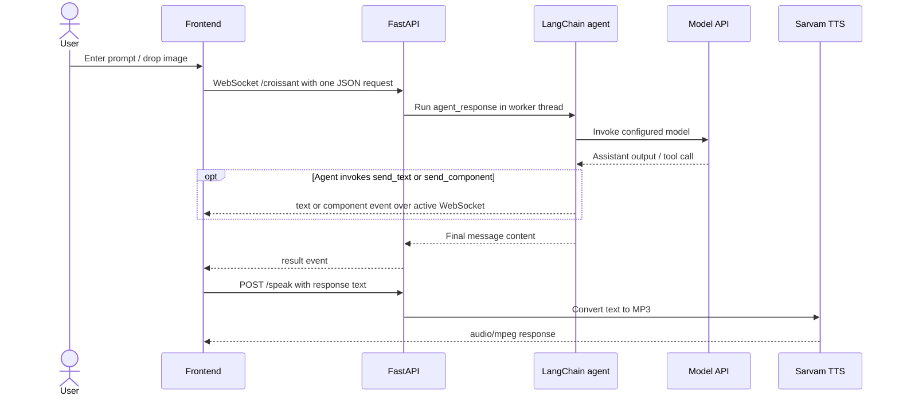

# Croissant Technical Documentation

Developer reference for the repository as inspected on 12 November 2026. Croissant currently implements a browser-based AI chat assistant. Assessment authoring, student submissions, AI grading, persistence, and faculty moderation are **not implemented**; they are not described here as operational features.

## Table of contents

- [Development environment](#1-development-environment-and-prerequisites)
- [Project structure](#2-project-structure)
- [Installation and local setup](#3-installation-and-local-setup)
- [Environment configuration](#4-environment-configuration)
- [HTTP and WebSocket APIs](#5-api-documentation)
- [Database](#6-database-documentation)
- [AI integration](#7-ai-integration-implementation-details)
- [Image/document processing](#8-document-processing)
- [Authentication and authorization](#9-authentication-and-authorization)
- [Implemented workflows](#10-business-logic-and-important-workflows)
- [Errors and edge cases](#11-error-handling-and-edge-cases)
- [Tests and validation](#12-testing-and-validation)
- [Known limitations](#13-known-limitations)
- [Contribution guide](#14-developer-contribution-guidelines)
- [Future development](#15-future-development)
- [Related documentation](#related-documentation)

## 1. Development environment and prerequisites

| Requirement | Repository evidence / use |
|---|---|
| Python | Python **3.14 or later** is required by `pyproject.toml`; `.python-version` selects `3.14`. |
| `uv` | Dependency manager is indicated by the checked-in `uv.lock`; use it to sync and run the backend. The repository does not pin a `uv` release. |
| Web browser | Needed for the static HTML/CSS/JavaScript frontend. The chat uses modern browser APIs including WebSocket, `FileReader`, `crypto.randomUUID` when available, and audio playback. |
| Python static server | `python -m http.server` can serve the frontend from the repository root. FastAPI does not serve static files. |
| Node.js | Not required to run the application. There is no `package.json` or frontend build step. |
| External model service | `agent.py` configures LangChain's `ChatOpenAI` adapter to `https://api.aicredits.in/v1`. A usable `api_key` credential is needed for model calls. |
| Speech service | Sarvam text-to-speech (`bulbul:v4-flash`) is imported during backend startup. `SARVAM_API_KEY` must be set for the app to import successfully. |
| Database | None. The project has no database engine, schema, migration, or database service requirement. |

The direct dependency constraints are in [`pyproject.toml`](../pyproject.toml), with resolved versions in [`uv.lock`](../uv.lock). Key locked versions include FastAPI 0.162.2, LangChain 1.4.9, langchain-openai 1.7.4, LangGraph 1.2.20, python-dotenv 1.2.4, python-multipart 0.0.33, sarvamai 0.1.45, and Uvicorn 0.54.0. These lockfile values describe the checked-in resolution, not a guarantee that future lock updates retain them.

## 2. Project structure

```text
.
├── app.py                       # FastAPI app and API route definitions
├── agent.py                     # Model adapter, LangChain agent construction/invocation
├── tools.py                     # Agent tools that emit text and component events
├── websocket.py                 # Active WebSocket context and event forwarding
├── Sarvam.py                    # Sarvam TTS client and MP3 conversion
├── system_promt.md              # Agent system prompt (filename spelling is intentional here)
├── pyproject.toml               # Python requirements and project metadata
├── uv.lock                      # Resolved Python dependency lock
├── .python-version              # Python version selector: 3.14
├── .gitignore                   # Ignores local .env and virtual environments
├── index.html                   # Static landing page
├── frontend/
│   ├── index.html               # Chat page
│   ├── script.js                # Chat, model selector, image, WebSocket, TTS UI
│   ├── auth.js                  # Frontend-only login/signup interactions
│   ├── login.html               # Non-authenticating login UI
│   ├── signup.html              # Non-authenticating signup UI
│   ├── styles.css               # Shared landing, chat, and auth styling
│   ├── assests/                 # Existing asset directory (spelled "assests")
│   │   ├── flourish_svg_assets/
│   │   └── Scatter assets/
│   └── components/
│       ├── calculator.html      # Browser calculator
│       ├── plot2d.html           # Browser 2D equation plotter
│       └── plot3d.html           # Browser 3D surface plotter
└── docs/
    ├── ARCHITECTURE.md          # Architecture, status boundaries, diagrams
    └── TECHNICAL_DOCUMENTATION.md
```

The root page links to `frontend/index.html` for chat and `frontend/login.html` / `frontend/signup.html` for static auth UI. The frontend is plain HTML/CSS/JavaScript; there is no router, framework, bundler, package manifest, or SPA state library. The three tool pages are loaded by the chat into sandboxed iframes.

## 3. Installation and local setup

The repository contains no configured Git remote URL or clone instructions. Clone it using the URL supplied by the project's host, then change into the repository root.

1. Install Python 3.14+ and `uv`.
2. From the repository root, install the locked dependencies:

   ```powershell
   uv sync
   ```

3. Create a local `.env` file in the repository root with the variables in [Environment configuration](#4-environment-configuration). `.env` is ignored by Git.
4. Start the backend in one terminal:

   ```powershell
   uv run python app.py
   ```

   The app runs Uvicorn on `0.0.0.0:8000` as written in `app.py`.

5. Start the static frontend in a second terminal, also from the repository root:

   ```powershell
   python -m http.server 8080
   ```

6. Open [http://localhost:8080](http://localhost:8080). The landing page is at `/`; chat is at `/frontend/index.html`. The auth pages are `/frontend/login.html` and `/frontend/signup.html`.
7. Stop each server with Ctrl+C.

The chat JavaScript currently targets `http://localhost:8000` and derives `ws://` for its WebSocket connection. This is a development assumption hardcoded in [`frontend/script.js`](../frontend/script.js), not a deployment configuration option. If the app is served remotely or behind HTTPS, API-origin configuration and secure transport need implementation.

## 4. Environment configuration

`python-dotenv` loads `.env` from the process working directory. Start `app.py` from the repository root so the prompt file and local environment file resolve as expected.

| Variable | Required? | Purpose | Placeholder example |
|---|---|---|---|
| `api_key` | Required for successful model requests; not validated at startup. | Passed to `ChatOpenAI` as the credential for the configured OpenAI-compatible model API. | `api_key=replace-with-provider-key` |
| `SARVAM_API_KEY` | Required at backend import/startup. | Passed to the Sarvam SDK as `api_subscription_key`. `Sarvam.py` accesses it with `os.environ[...]`. | `SARVAM_API_KEY=replace-with-sarvam-key` |

Example local `.env` contents (placeholders only):

```dotenv
api_key=replace-with-provider-key
SARVAM_API_KEY=replace-with-sarvam-key
```

Do not commit `.env` or put either credential in frontend files. There are no configured database, auth-provider, or OCR environment variables in this repository.

## 5. API documentation

All APIs are defined directly in [`app.py`](../app.py). No endpoint requires authentication; there are no roles or authorization middleware. FastAPI uses wildcard CORS (`*`) for origins, methods, and headers.

### Chat

| Method / URL | Request | Success | Errors / notes |
|---|---|---|---|
| `POST /croissant` | Required query parameters: `query`, `model_name`, `thread_id`. Optional multipart file field: `image`. | Agent response returned as a Python string, serialized by FastAPI as a JSON string response. | Missing required parameters or invalid request shape generally yields FastAPI `422`. Model/provider/runtime exceptions are not caught in this HTTP handler and result in a server error. No auth. |
| `WS /croissant` | After connection acceptance, send one JSON object: `query`, `model_name`, `thread_id`, optional `image` (base64 string), optional `image_media_type` (MIME string). | Zero or more tool events, then `{"type":"result","content":...}`. | Exceptions are sent as `{"type":"error","content":"<exception text>"}`. A disconnect is ignored. The handler receives only one request message per socket. No auth. |

Example WebSocket request:

```json
{
  "query": "Explain this picture",
  "model_name": "openai/gpt-6-luna",
  "thread_id": "a-browser-generated-uuid",
  "image": null,
  "image_media_type": null
}
```

Example event payloads actually handled by the browser:

```json
{"type":"text","content":"A response fragment."}
{"type":"component","name":"plot2d","props":{"equation":"sin(x)"}}
{"type":"result","content":"The final response."}
{"type":"error","content":"Provider error detail"}
```

`tools.py` emits `text` and `component`; `app.py` emits `result` and `error`. The frontend also contains a handler for `tool_update`, but no current tool calls the `send_tool_update` producer.

For the HTTP upload variant, `query`, `model_name`, and `thread_id` are query parameters and `image` is a multipart file. For example:

```bash
curl -X POST \
  'http://localhost:8000/croissant?query=Hello&model_name=openai%2Fgpt-6-luna&thread_id=local-test' \
  -F 'image=@./example.png'
```

### Speech

| Method / URL | Request | Success | Errors / notes |
|---|---|---|---|
| `POST /speak` | Required query parameter `text`; optional query parameter `language`, default `en-US`. No request body is read. | Raw MP3 bytes with `Content-Type: audio/mpeg`. | Missing `text` yields `422`; Sarvam/provider exceptions are not caught in the route and produce a server error. No auth. |

Example:

```bash
curl -X POST --get 'http://localhost:8000/speak' \
  --data-urlencode 'text=Hello from Croissant' \
  --data-urlencode 'language=en-IN' \
  --output response.mp3
```

The frontend uses `en-IN` and expects an audio content type before playback.

### Health

| Method / URL | Request | Success | Errors / notes |
|---|---|---|---|
| `GET /health` | None. | JSON `{"status":"alive"}`. | No dependency checks or authentication are performed. |

### Modules requested but absent

There are no authentication, user management, assessment, question, rubric, submission, AI grading, feedback, faculty moderation, or audit-log API endpoints. Do not infer routes for those modules from UI copy or the proposed assessment workflows in the architecture document.

## 6. Database documentation

**No database is implemented.** There are no database packages in `pyproject.toml`, database configuration files, ORM models, schema files, migrations, indexes, or persistence/repository modules. Consequently there are no database tables, fields, primary/foreign keys, constraints, or relationships to document.

No assessments, questions, rubrics, student submissions, AI results, faculty overrides, or audit records are persisted. The LangGraph `InMemorySaver` is created inside each `agent_response` invocation; it is process memory, recreated for each call, and is not a durable conversation store. The frontend's thread UUID is a request identifier, not a database key.

## 7. AI grading engine — implementation details

### Implemented AI behavior: general chat only

`agent.py` implements `get_model(model_name)` and `agent_response(query, image, image_media_type, model_name, thread_id)`:

1. `ChatOpenAI` is configured with the model ID supplied by the frontend, `api_key` from the environment, and base URL `https://api.aicredits.in/v1`.
2. A LangChain agent is created with the system prompt from `system_promt.md`, tools `send_text` and `send_component`, and a new `InMemorySaver`.
3. Text-only input is passed as a user message. When image bytes are supplied, they are base64-encoded into a `data:<media-type>;base64,...` image URL alongside the prompt.
4. The agent is invoked once with the current user message and a config containing `thread_id`.
5. The final message's `content` is returned. During tool execution, tools may emit text or component events to the active WebSocket.

The model choices in [`frontend/script.js`](../frontend/script.js) are GPT-6 Luna, GPT-5.6 Luna, DeepSeek V4.1 Flash, MiniMax M3.1 Flash, GLM 5.3 Flash, Qwen 3.5 Flash, Mistral Small 4, and Claude Haiku 5.5, each paired with a provider model ID in that source file. The backend does not enforce an allowlist independently.

### Actual system prompt

The current prompt is a general assistant prompt, not a grading template. Its key instructions in [`system_promt.md`](../system_promt.md) are:

```text
You are Croissant. You are an AI Agent under early development and testing.

- Keep you answer minimal and small
- Joke around a bit.
- For most queries reply in a single sentence.

- send_component(name, props) can send premade components to the frontend.
- When the user asks for a calculator, call send_component with name "calculator" and an empty props object. Do not just describe the component.
- When the user asks to plot a 2D equation, call send_component with name "plot2d" and props containing an equation string, such as {"equation": "sin(x)"}. That equation becomes the editable default in the plotter.
- When the user asks for a 3D graph or surface, call send_component with name "plot3d" and props containing an equation in x and y, such as {"equation": "sin(sqrt(x^2+y^2))"}. That equation becomes the editable default in the plotter.
```

The prompt then lists calculator, 2D plotter, and 3D surface plotter as available components. The source spelling is `system_promt.md` (missing the second “p” in “prompt”); the code loads that exact path relative to the current working directory.

### Tools and component output

| Tool | Input | Behavior |
|---|---|---|
| `send_text` | `text: str` | Prints the text and sends `{"type":"text","content":text}` through the active WebSocket context. |
| `send_component` | `name: str`, `props: dict` | Prints arguments and sends `{"type":"component","name":name,"props":props}`. The browser renders only names it maps: calculator, plot2d, plot3d. Plot equation props are appended to the plotter URL. |

### Grading-specific functionality

**Not implemented:** question/reference-answer/rubric/student-answer preparation; semantic grading; rubric criterion evaluation; partial credit; score calculation; structured grading output; score-boundary or JSON validation; grade feedback; retry/review status; faculty verification. There is no grading response schema or grading prompt in the repository. Do not use the chat agent as an implemented grading engine.

## 8. Document processing

The chat frontend supports drag-and-drop of a file whose browser MIME type starts with `image/`. It reads the image using `FileReader`, sends base64 over WebSocket, and displays a local preview. The backend base64-decodes it and passes the bytes and media type to the model as an image data URL.

There is no named format allowlist, backend MIME verification, size limit, persistent file storage, extraction service, PDF parser, OCR, handwriting recognition, normalization pipeline, or document-processing error taxonomy. Non-image files are rejected by the frontend with a status message; no PDF or office-document workflow is implemented. The HTTP `/croissant` route accepts an `UploadFile` but contains no explicit type/size validation. Do not treat image attachment as a general document-ingestion system.

## 9. Authentication and authorization

`frontend/login.html` and `frontend/signup.html` are static UI only. [`frontend/auth.js`](../frontend/auth.js) toggles password visibility, performs browser-side required/email/username/password/confirmation/terms checks, and shows messages that account access is not connected. Form submission is prevented and sends no credentials to a server. Login's remember-me checkbox is visual only; forgot-password feedback is UI-only; terms acceptance is not sent to a service. Auth inputs start `readonly` with autocomplete disabled, then become editable on first focus to discourage browser autofill. No auth tokens, cookies, sessions, or persistent credential storage are implemented.

There is no server authentication, user model, role system, permission check, or protected route. All FastAPI routes are public. A frontend form or a successful client-side validation must not be treated as sign-in or access control.

## 10. Business logic and important workflows

### Implemented chat request



The HTTP `POST /croissant` route invokes the same `agent_response` function without the WebSocket tool-event context; the frontend chat uses the WebSocket route. The assistant's final message is not persisted.

### Assessment-related workflows

Assessment creation, question/reference-answer configuration, rubric creation, student submission/persistence, grading initiation, score calculation, feedback persistence, faculty moderation, override, approval, and audit history are **not present**. No relevant endpoints or business logic should be added to the developer workflow until an assessment feature is designed and implemented.

## 11. Error handling and edge cases

| Case | Current behavior |
|---|---|
| Empty frontend chat | `send()` returns without opening a socket when both prompt and attached image are empty. An image-only send uses the default text “What is in this image?”. |
| Unsupported dropped file | Frontend checks `file.type.startsWith("image/")`; otherwise it displays “Please drop an image file.” Backend validation is not equivalent or comprehensive. |
| Image read failure | `FileReader.onerror` rejects; the chat error path renders the exception text. |
| Missing HTTP query parameters | FastAPI request validation returns `422`. |
| WebSocket exception / missing expected data | The handler catches exceptions and sends an `error` event containing `str(exc)`; it does not define a structured error code schema. |
| WebSocket disconnect | `WebSocketDisconnect` is ignored; the active context token is reset in `finally`. |
| Model provider failure | WebSocket path reports an error event; HTTP route has no local exception handler. No bounded retry or fallback provider logic is implemented. |
| TTS failure | Frontend catches request/audio errors and marks the play control unavailable. Backend route itself does not convert provider failures to a custom response. |
| Missing `SARVAM_API_KEY` | Import-time `os.environ[...]` lookup raises, preventing backend startup. |
| Invalid grading response, missing reference/rubric, duplicate submission, unauthorized access, database error, score override | Not applicable to implemented features; no such validation, persistence, routes, or workflows exist. |

Provider exception text is returned to the WebSocket client as-is. A production deployment should review whether these details are appropriate for clients; no safer error mapping is currently defined.

## 12. Testing and validation

The repository has no first-party test directory or test files, no test dependency, no test command, and no coverage configuration. `pyproject.toml` defines dependencies only; there is no frontend package manifest or build/lint script. Files discovered under virtual environments are installed dependency files, not project tests.

Do not report test coverage or successful unit/integration/API/grading tests for this codebase. There are no AI grading or submission-processing tests because those components are absent. A future test suite should cover API validation and event contracts, model/provider errors, image payload boundaries, frontend interaction, and authentication UI non-transmission behavior.

### Proposed grading evaluation methodology

No grading evaluation currently runs and no score dataset or benchmark exists. If grading is introduced, compare model outputs with independently assigned human scores using a versioned test set and blinded review:

- **Mean Absolute Error (MAE):** `MAE = (1/N) × Σ |AI score_i − human score_i|`, computed overall and per assessment/question.
- **Criterion-level accuracy:** Compare each criterion's awarded marks with an agreed human reference; define acceptable tolerance and weighting before reporting a result.
- **Partial-credit consistency:** Measure agreement on partial-credit decisions across repeated model runs and against multiple human graders, with rubric version and model configuration held constant or recorded.
- **Feedback quality:** Have reviewers assess correctness, evidence alignment, clarity, and usefulness against a predefined rubric. Report sample size and inter-rater method; do not infer these from score agreement alone.

These are recommended evaluation methods, not current metrics or results.

## 13. Known limitations

- Model calls depend on an external OpenAI-compatible provider and a configured credential; network/provider latency and availability affect chat responses.
- The code does not specify request timeouts, retries, rate limits, model-output size limits, or provider fallback behavior.
- A browser thread ID is passed to an in-memory saver recreated per request; durable multi-request conversation history is not implemented.
- Image attachment has no explicit application-side size cap or robust server-side content validation. PDF/OCR/handwriting support is absent.
- The selected model ID is supplied by the frontend and is not independently allowlisted by the backend.
- Text-to-speech adds a second external provider call; failures result in unavailable audio. Provider data handling is not configured here.
- Frontend authentication screens do not authenticate users; all backend endpoints remain public.
- There is no AI grading feature, so LLM grading variability, criterion consistency, faculty verification, and grade correctness have not been measured or implemented.

## 14. Developer contribution guidelines

No `AGENTS.md`, formatter/linter config, or project-specific test convention was found. Follow the existing local style: Python functions and variables use `snake_case`; browser JavaScript mostly uses `camelCase`; frontend is plain HTML/CSS/JavaScript with shared styles in `frontend/styles.css`.

| Change | Current extension point |
|---|---|
| Add an HTTP endpoint | Add a FastAPI route in `app.py`; document request validation and response behavior. There is no separate router/service package today. |
| Change model invocation or input handling | Update `agent.py`; keep credentials on the backend and update the system instructions in `system_promt.md` when behavior changes. |
| Add an agent tool/event | Define the tool in `tools.py`, implement event serialization/forwarding in `websocket.py` if needed, and update the frontend event switch in `frontend/script.js`. |
| Add a frontend component | Add a static document under `frontend/components/`, map its event name in `frontend/script.js`, and constrain its iframe sandbox requirements. |
| Change TTS | Update `Sarvam.py` and/or `/speak` in `app.py`; preserve the `audio/mpeg` response expected by the frontend. |
| Add assessment/grading support | This is new product functionality, not an extension of an existing grading subsystem. First specify domain, persistence, auth, validation, moderation, and tests; then add these as new documented capabilities. |
| Validate a change | No repository test command exists. At minimum, inspect the changed paths and exercise the affected workflow manually; add automated tests with any new nontrivial behavior. Do not claim unrun checks. |

Avoid committing `.env`, credentials, local virtual environments, or generated artifacts. The current `.gitignore` excludes `.env`, `.venv`, and `.venv-1`.

## 15. Future development

Possible future work, all **not implemented**, includes PDF/text extraction, advanced OCR for handwritten answers, embedding-assisted semantic evaluation, mathematical step evaluation, sandboxed programming assignment grading, retrieval-augmented study-resource recommendations, background/batch processing, analytics, and using faculty corrections to evaluate and improve grading. Any grading extension also needs persistent versioned records, authentication/authorization, structured output validation, auditability, and faculty review before grades can be treated as final.

## Related documentation

- [Project README](../README.md) — currently empty; no setup or feature details are maintained there.
- [Architecture and diagrams](ARCHITECTURE.md) — system boundaries, component responsibilities, current and proposed data flows, and trade-offs.
- [FastAPI routes](../app.py), [agent integration](../agent.py), [agent tools](../tools.py), [WebSocket bridge](../websocket.py), [Sarvam integration](../Sarvam.py), [system prompt](../system_promt.md).
- [Frontend chat](../frontend/index.html), [chat behavior](../frontend/script.js), [authentication UI behavior](../frontend/auth.js), [dependency declarations](../pyproject.toml), and [locked dependencies](../uv.lock).
